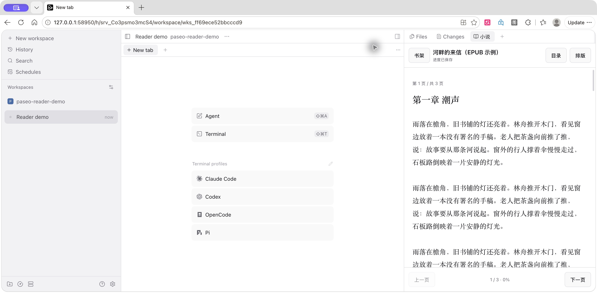

# Paseo Reader

在 Paseo 聊天右侧阅读本地 TXT / EPUB 小说，同时保留主聊天和输入框。



截图来自独立演示工作区，展示示例小说，不包含个人书籍或会话。

## 功能

- 本地书架、书名与作者搜索。
- 桌面端和浏览器选择 TXT / EPUB 上传，显示上传进度并支持取消；也可从 daemon 主机导入。
- TXT 中文章节识别，自动识别 UTF-8、GB18030 和带 BOM 的 UTF-16，也可手动指定编码。
- EPUB 按阅读顺序提取文字和章节目录。
- 翻页、章节搜索与跳转，自动保存页码和页内位置。
- 调整字号、宋体 / 系统字体和行距，跟随 Paseo 深浅主题。

## 安装

需要 Paseo 0.11.1 或更新版本，并在 Paseo 设置中启用插件。运行 Paseo daemon 的主机需要可用的 npm；安装时会按 `package-lock.json` 下载运行依赖，禁用依赖的生命周期脚本。

```sh
paseo plugin add git:Rearpoem/paseo-reader
```

当前通过 GitHub 直接安装，尚未上架 Paseo 插件市场。插件 ID 为 `novel-reader`。

## 使用

1. 打开聊天工作区右上角的侧边面板。
2. 点击侧栏顶部「＋」→「小说」。macOS 也可按 `⌘K`，选择「在侧栏阅读小说」。
3. 点击「导入小说」→「上传文件」→「选择文件」，从当前设备选择 TXT / EPUB，确认文件名和大小后点击「上传到书架」。也可切换到「主机文件」，浏览 daemon 主机上的文件或粘贴完整路径。
4. 点击书名阅读。「目录」跳转章节，「排版」调整阅读样式。

macOS 可按 `⌘E` 收起或展开侧栏。重新打开后，点击「继续阅读」恢复阅读位置。

## 数据与限制

插件只读取用户选定的小说，浏览文件夹时列出目录和 TXT / EPUB 文件名。导入会保存文字副本，不修改原文件；重复导入相同内容和编码会保留已有进度。

文件上传通过当前 Paseo 连接分块发送到 daemon 主机；传输完成后解析并加入同一个书架。取消或未完成的上传不会加入书架，暂存内容在内存中保留，取消或插件退出时清除，停止传输 10 分钟后过期。上传页不会自动浏览主机目录。桌面端和浏览器支持文件选择；iOS / Android 原生 App 暂时保留主机文件导入入口。

书架、正文、阅读进度和设置保存在 daemon 主机的 `~/.paseo/plugin-data/novel-reader/`；设置 `PASEO_HOME` 时跟随该目录。连接这台主机的 Paseo 客户端可以访问书架，远程阅读时正文会传到连接的客户端。插件不调用 AI，不向第三方服务发送小说正文。仓库不包含小说文件或个人阅读记录。

- 单本文件最大 50 MB，正文最多 3000 万字符。
- EPUB 以纯文字阅读为主，不保留图片、复杂版式或脚注跳转，不支持 DRM。
- 页码按固定文字片段划分，不对应纸书页码。
- 当前实际界面验收平台为 macOS Paseo 0.11.1；其他系统和移动端尚未实机验收。

## 本地开发

```sh
git clone https://github.com/Rearpoem/paseo-reader.git
cd paseo-reader
npm ci --ignore-scripts
npm run typecheck
paseo plugin add "$PWD"
```

修改后使用 `paseo plugin reload novel-reader` 重载，使用 `paseo plugin logs novel-reader` 查看日志，无须重启 daemon。安装准备步骤只保留运行依赖；需要再次类型检查时，运行 `npm ci --ignore-scripts` 恢复开发依赖。

## 已验证范围

在 macOS Paseo 0.11.1 的实际界面中验证过：

- 右侧书架和正文与主聊天并排显示，侧栏收起与重新打开。
- UTF-8 TXT、GB18030 TXT、EPUB 3 导入、中文正文、翻页和目录跳转。
- 阅读位置恢复、排版设置保存、重复导入、搜索与无匹配结果。
- 空白 TXT、损坏 EPUB 的错误提示和恢复。
- 紧凑布局与深浅主题。

未新增、修改或运行单元测试。未覆盖 UTF-16 样本、全部 EPUB 变体、超大长篇或移动端实机。

本次上传后端已在独立 Paseo 0.11.1 daemon 上通过真实 WebSocket / RPC 操作验证：UTF-8、GB18030、EPUB 上传与读取、超过单块大小的文件传输、重复导入保留进度、部分上传取消与重新上传、空文件和损坏文件拒绝、50 MB 元数据上限、未完整传输拒绝、错误分块拒绝、并发上传上限，以及原路径导入。

新增界面的文件选择、进度显示和取消交互待用户手动验收；此前的界面验收不覆盖这些新功能。尚未验证弱网中断、远程中继、10 分钟超时清理及 50 MB 实际文件传输。
